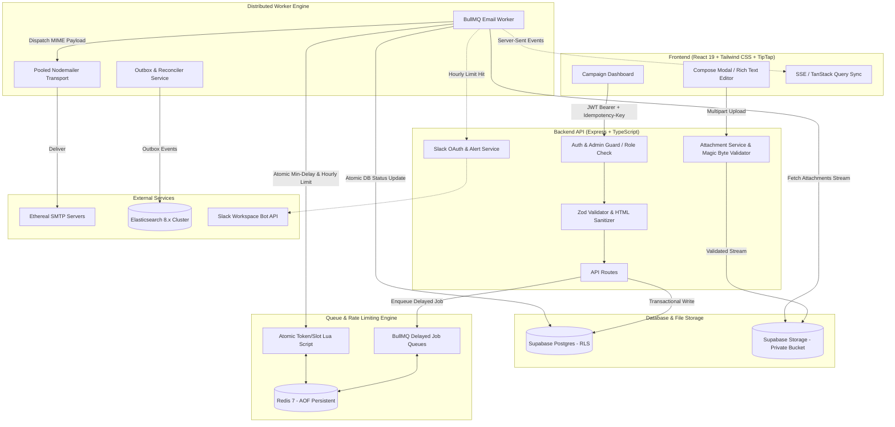

# ReachInbox Email Scheduler & Outreach Engine

A production-grade, distributed email scheduler and campaign dashboard built with **Express + TypeScript**, **BullMQ + Redis**, **Supabase Postgres + Google Auth**, **Supabase Storage**, **Elasticsearch**, **Ethereal SMTP**, **Slack OAuth**, and **React 19 + Tailwind CSS**.

Engineered for **zero-drop reliability**: restart persistence without cron, atomic rate-limiting, tenant isolation, shared senders with role enforcement, rich text email authoring, file attachments, and real-time live UI updates.

---

## 🏛️ System Architecture



---

## ⚡ How to Run (Crisp & Short)

### 1. Prerequisites
- **Node.js**: `>= 20.0.0`
- **Docker**: For local Redis & Elasticsearch (`docker compose up -d`)
- **Supabase**: Postgres database & Google Auth credentials

### 2. Configure Environment
Copy and populate the environment files:
```bash
# Backend environment
cp .env.example backend/.env

# Frontend environment
cp frontend/.env.example frontend/.env
```

Ensure `CREDENTIAL_ENCRYPTION_KEY` in `backend/.env` is a 32-byte (64 hex characters) string:
```bash
node -e "console.log(require('crypto').randomBytes(32).toString('hex'))"
```

### 3. Start Infrastructure (Redis & Elasticsearch)
```bash
docker compose up -d
```

### 4. Install & Run

**Terminal 1 — Backend (API & Worker on port 4000):**
```bash
cd backend
npm install
npx prisma generate
npx prisma migrate deploy
npm run dev
```

**Terminal 2 — Frontend (Vite on port 5173):**
```bash
cd frontend
npm install
npm run dev
```

Visit **`http://localhost:5173`** to use the application.

---

## 🧪 Automated Testing

Run the full regression test suite (17 test suites, 74 tests):
```bash
cd backend
npm test
```

Build verification (type-checking & bundle builds):
```bash
# Backend build
cd backend && npm run build

# Frontend build
cd frontend && npm run build
```

---

## 🛡️ Core Reliability & Architectural Guarantees

| Capability | Guarantee & Implementation Details |
|---|---|
| **Restart Persistence** | **Zero in-memory timers or cron polling**. Scheduled campaigns are committed to Postgres and enqueued into BullMQ Redis with deterministic Job IDs (`email:<emailId>`). Survived process crashes immediately resume on restart. |
| **Strict Acceptance** | Worker transitions to `sent` **only** if Nodemailer `info.accepted` contains the recipient, `info.rejected` is empty, and response is `250 OK`. Rejections transition immediately to `failed`. |
| **Ambiguous DB Retry** | If database update fails after SMTP acceptance, worker executes an **isolated DB retry loop** (up to 5 exponential backoff attempts) without re-sending the email, guaranteeing no double-sends. |
| **Stalled Worker Recovery** | Crash recovery automatically reconciles stalled `processing` jobs via deterministic reconciliation on worker boot, preventing stuck states. |
| **Atomic Rate Limiter** | Redis Lua script executes atomic checks: reserves the next sender time slot (`min_delay_seconds`) and checks fixed UTC hourly window quotas. Over-quota emails are rescheduled to the next window. |
| **Shared Senders & Caps** | Admins configure senders globally (`role: admin`). Non-admin users select shared senders but cannot view SMTP secrets. Campaign limits enforce sender maximums server-side (`HOURLY_LIMIT_EXCEEDS_SENDER_CAP`). |
| **Safe File Attachments** | Authenticated multipart uploads to private Supabase storage. Validates real file magic bytes (PDF, images, Office docs, archives) to prevent spoofing. Worker streams files directly to SMTP. |
| **Rich Text Authoring** | TipTap ProseMirror editor with full formatting toolbar (undo/redo, headings, bold, italic, underline, alignments, lists, quote, links). Server sanitizes HTML with strict tag allowlist. |
| **Realtime Dashboard** | SSE stream (`/api/emails/events`) combined with TanStack Query auto-refetch dynamically moves items from **Scheduled** to **Sent** without manual browser refreshes. |
| **Decoupled Slack Alerts** | Tamper-proof HMAC signed OAuth state (`${userId}.${timestamp}.${nonce}.${hmac}`). Triggers exactly one alert per sender per quota window without blocking queue processing if unconfigured. |

---

## 👥 Roles & Permissions Matrix

| Resource / Action | Admin | Regular User |
|---|:---:|:---:|
| View Dashboard (Own Campaigns & Emails) | ✅ | ✅ |
| Compose & Schedule Email Campaigns | ✅ | ✅ |
| Upload & Download File Attachments | ✅ | ✅ |
| Choose From Shared Senders in Compose | ✅ | ✅ |
| Create, Edit, or Delete Senders | ✅ | ❌ *(403 Forbidden)* |
| View SMTP Credentials (Host, User, Pass) | ✅ | ❌ *(Stripped from response)* |
| Access BullMQ Dashboard (`/admin/queues`) | ✅ | ❌ *(403 Forbidden)* |
| Set Per-Sender Minimum Delay & Hourly Limit | ✅ | ❌ *(Read-only caps)* |

> **Bootstrap Admins**: Add admin emails to `ADMIN_EMAILS` in `backend/.env` (e.g. `ADMIN_EMAILS=admin@reachinbox.ai,your-email@domain.com`).

---

## 📁 Key Project Directories

```
reachinbox-email-scheduler/
├── backend/
│   ├── prisma/             # Schema & additive SQL migrations
│   ├── src/
│   │   ├── config/         # Environment & Zod validation
│   │   ├── controllers/    # Express controllers
│   │   ├── middleware/     # Auth, requireAdmin, error handling
│   │   ├── queue/          # BullMQ queue definitions & Redis connection
│   │   ├── routes/         # API routes (emails, campaigns, senders, slack, attachments)
│   │   ├── services/       # Business logic (campaign, sender, attachments, rate-limiter, slack)
│   │   └── worker/         # Email dispatch worker with SMTP pool & retry logic
│   └── tests/              # 17 test suites (Unit, Integration, E2E)
├── frontend/
│   ├── src/
│   │   ├── components/     # ComposeModal, EmailList, SendersModal, Sidebar, TopBar
│   │   ├── lib/            # API client, Supabase client, auth helpers
│   │   └── App.tsx         # Dashboard layout, SSE event listeners, route management
│   └── tests/              # Frontend component test suite
├── docker-compose.yml      # Local Redis 7 & Elasticsearch 8 cluster
└── docs/                   # PROGRESS.md, architecture notes, and setup guides
```
